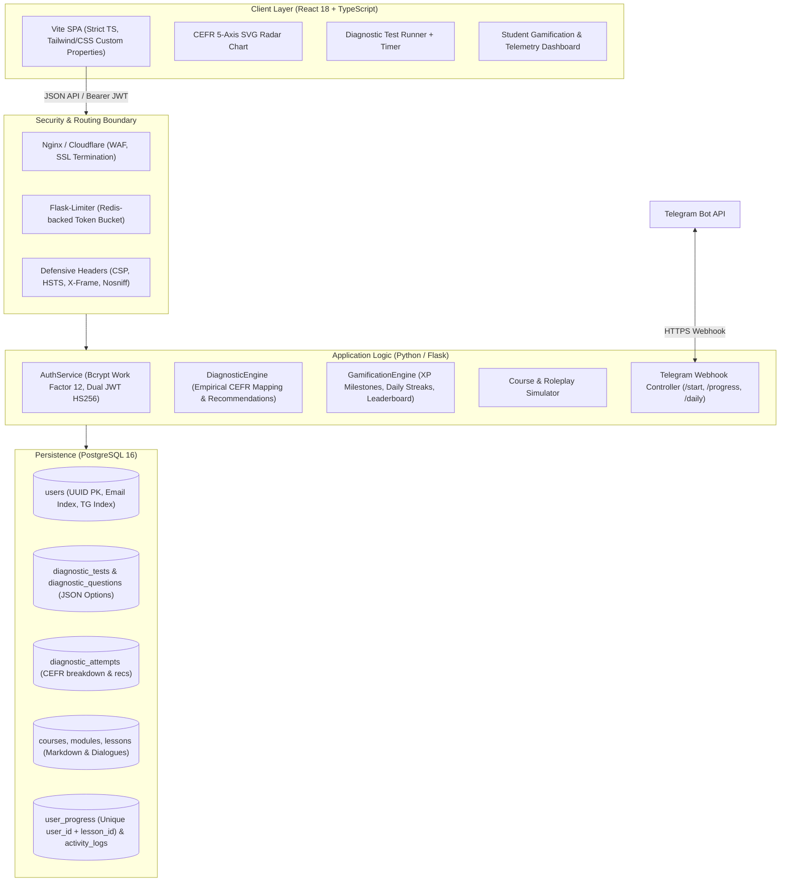

# Phoenix Learning Center · Architecture & Security Specification

**Domain:** EdTech Platform for Software Engineers, Tech Leads & Product Managers (Business & IT English)  
**Standard:** International CEFR Framework (A1 – C2)  
**Core Features:** 5-Axis Placement Assessment Engine, Diagnostic Competency Radar, Gamified XP & Streak Telemetry, Telegram Bot Synchronisation, B2B Enterprise Cohorts.

---

## 1. System Architecture



---

## 2. Relational Database Schema Design

The schema is built on top of **PostgreSQL 16** with strict foreign keys, cascade rules, composite unique constraints, and automated UTC timestamp tracking.

### Tables & Relationships
- **`users`**:
  - `id` (VARCHAR(36), PK): UUIDv4
  - `email` (VARCHAR(255), UNIQUE, INDEX): Lowercase sanitized address
  - `password_hash` (VARCHAR(255)): Bcrypt hashed string
  - `full_name` (VARCHAR(120)): XSS-sanitized full name
  - `role` (VARCHAR(30)): `student`, `corporate_lead`, or `admin`
  - `cefr_level` (VARCHAR(5)): `A1` through `C2`
  - `target_domain` (VARCHAR(50)): `IT`, `Business`, `Executive`
  - `xp_points` (INTEGER): Total accumulated experience points
  - `streak_days` (INTEGER): Consecutive daily engagement counter
  - `telegram_id` (VARCHAR(50), UNIQUE, INDEX): Deep-linked Telegram chat ID
  - `telegram_username` (VARCHAR(100))

- **`diagnostic_tests` & `diagnostic_questions`**:
  - Normalized 1-to-many relationship with `ondelete="CASCADE"`.
  - Questions are weighted by CEFR difficulty (`weight` 1 to 3) across 4 core competencies: `grammar`, `tech_vocab`, `architecture_reading`, `business_negotiation`.
  - Options are stored in JSON (`id`, `text`, `is_correct`, `explanation`). The API strictly strips `is_correct` and `explanation` prior to delivery to prevent frontend cheating.

- **`diagnostic_attempts`**:
  - Stores full audit trail of each test run, whether performed by authenticated students or pre-signup B2C/B2B marketing leads.
  - Generates numerical breakdowns for Grammar, Tech Vocab, and Comprehension, and assigns the official CEFR rank.

- **`courses` -> `course_modules` -> `lessons`**:
  - Hierarchical structure with order indexes.
  - Lessons contain Markdown study guides plus structured `scenario_roleplay` dialogues for simulated standups and code reviews.

- **`user_progress`**:
  - Enforces `UniqueConstraint("user_id", "lesson_id")` to prevent XP duplication and ensure reliable progress tracking.

---

## 3. Offensive & Defensive Security Audit

| Threat Vector | Severity | Offensive Attack Vector | Defensive Architecture & Implementation |
| :--- | :--- | :--- | :--- |
| **SQL Injection (SQLi)** | Critical | `admin@tech.io' OR '1'='1` or union-based exploitation | 100% Parameterized ORM queries via SQLAlchemy 2.0. Direct string interpolation is strictly banned across all repositories. |
| **Cross-Site Scripting (XSS)** | High | `<script>alert('pwned')</script>` in registration names or roleplay inputs | Input sanitization layer (`html.escape` and control character stripping) in `app.utils.security.sanitize_string` + strict CSP headers. |
| **Answer Key Leakage** | High | Inspecting API network tab to find correct options | `DiagnosticQuestion.to_dict(include_answers=False)` removes `is_correct` and `explanation` keys during test execution. |
| **JWT Tampering / Forgery** | High | Altering user ID or role inside unsigned token payload | Cryptographic HS256 signature verification with dedicated `JWT_SECRET_KEY`, short-lived 30m access tokens, and refresh token rotation. |
| **Credential Brute Force** | Medium | Automated dictionary attack on `/api/v1/auth/login` | Rate limiting via Flask-Limiter (token bucket) + bcrypt with work factor 12 (constant-time password comparison). |
| **Clickjacking & MIME Sniffing** | Medium | Embedding application inside malicious iframe | HTTP headers `X-Frame-Options: DENY`, `X-Content-Type-Options: nosniff`, `Referrer-Policy: strict-origin-when-cross-origin`. |

---

## 4. API Specification Summary

### Authentication (`/api/v1/auth`)
- `POST /register`: Registers learner, awards 100 welcome XP, and returns `{ user, tokens }`.
- `POST /login`: Authenticates credentials, increments streak, and returns `{ user, tokens }`.
- `POST /refresh`: Rotates access and refresh tokens.
- `GET /me`: Returns profile, current rank, and level progression metrics.
- `POST /telegram/link`: Connects Telegram account to user profile.

### Diagnostic Engine (`/api/v1/diagnostic`)
- `GET /tests`: Lists active placement tests.
- `GET /tests/<slug>`: Retrieves questions with answers omitted.
- `POST /submit`: Evaluates user choices, calculates 5-axis scores, assigns CEFR level, records attempt, and outputs personalized recommendations.
- `GET /results/<attempt_id>`: Retrieves completed assessment report.
- `POST /lead`: B2B Enterprise consultation lead capture.

### Courses & Gamification (`/api/v1/courses`, `/api/v1/analytics`)
- `GET /courses`: Syllabus catalog.
- `GET /courses/<slug>`: Course modules with completion status flags.
- `POST /courses/lessons/<id>/complete`: Awards XP, logs activity, updates daily streak.
- `GET /analytics/dashboard`: Student telemetry, 5-axis CEFR Radar data, and recent activity feed.
- `GET /analytics/leaderboard`: Community XP rankings.

### Telegram Webhooks (`/api/v1/webhooks`)
- `POST /telegram`: Automated bot response for `/start`, `/progress`, and `/daily` micro-learning prompts.

---

## 5. Quickstart & Verification

### Run Backend & Tests
```bash
cd phoenix-platform/backend
python3 -m venv venv && source venv/bin/activate
pip install -r requirements.txt
pytest -v tests/
python3 wsgi.py
```

### Run Frontend
```bash
cd phoenix-platform/frontend
npm install
npm run dev
```

### Dockerized Environment
```bash
cd phoenix-platform
docker-compose up --build
```
